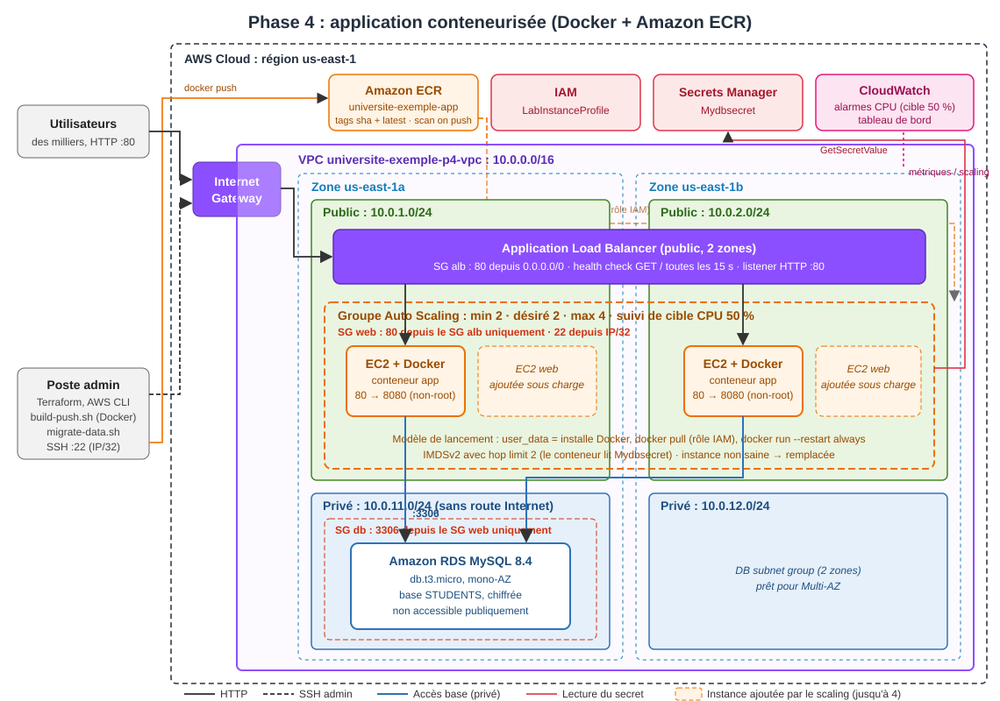

# Application web hautement disponible et scalable sur AWS avec Terraform

Preuve de concept pour l'**Université Exemple** : héberger l'application de gestion des dossiers étudiants sur AWS. Pendant les pics d'admission, elle doit **tenir des milliers d'utilisateurs** en étant **hautement disponible**, **sécurisée**, **performante** et **peu coûteuse**, selon le cadre AWS Well-Architected.

Tout est décrit en **Terraform**, déployé et **testé réellement** dans un lab AWS Academy. Le projet est construit en 5 phases, chacune avec son schéma, son code et son rapport.

## Les phases

| Phase | Contenu | Résultat clé | Dossier |
|---|---|---|---|
| **1. Application de base** | VPC, 1 instance EC2 avec l'application et MySQL | Application en ligne, opérations CRUD fonctionnelles | [phase1/](phase1/README.md) |
| **2. Découplage** | RDS MySQL privé, Secrets Manager, migration des données, **modules Terraform** | Base inaccessible depuis Internet, aucun mot de passe dans le code | [phase2/](phase2/README.md) |
| **3. Haute disponibilité et scalabilité** | ALB, modèle de lancement, Auto Scaling (2 à 4 instances, 2 zones), tableau de bord CloudWatch | **599 887 requêtes à 1 000 req/s, 1 erreur**, scale-out automatique 2 → 4 | [phase3/](phase3/README.md) |
| **4. Packaging** | Dockerfile, registre Amazon ECR, instances qui exécutent l'image | Image non root, 0 vulnérabilité (scan ECR), testée en local et sur EC2 | [phase4/](phase4/README.md) |
| **5. CI/CD** | GitHub Actions : build → qualité → push → test de charge → production | Déploiement sans interruption : **545 / 545 requêtes réussies** pendant le remplacement des instances | [phase5/](phase5/README.md) |

Chaque README de phase contient un **guide pas à pas** (de zéro jusqu'à l'application en ligne), les **tests réalisés avec leurs résultats chiffrés**, les **choix techniques**, les **difficultés rencontrées** et les **limites**.

## Architecture finale



| Exigence du sujet | Réponse |
|---|---|
| Fonctionnelle | Afficher, ajouter, modifier et supprimer, vérifié automatiquement par `test-app.sh` à chaque déploiement |
| Équilibrage de charge | Application Load Balancer sur 2 zones : répartition mesurée à 150 / 150 |
| Mise à l'échelle | Auto Scaling avec suivi de cible (50 % de CPU), de 2 à 4 instances |
| Haute disponibilité | 2 zones, instances remplacées automatiquement (health check ELB), application toujours accessible quand une instance est arrêtée |
| Sécurité | RDS en sous-réseaux privés ; chaîne de security groups ALB → web → base ; identifiants dans Secrets Manager lus via le rôle IAM ; IMDSv2 ; chiffrement EBS et RDS ; conteneur non root |
| Coûts optimisés | `t3.micro` et `db.t3.micro`, pas de NAT Gateway, mono-AZ pour la base (autorisé par le sujet), cycle de vie ECR, scale-in automatique |
| Performance | Latence médiane de 93 ms depuis la France sous 1 000 req/s (essentiellement le réseau transatlantique) |

## Organisation du dépôt

```
.
├── app/                    # Code de l'application fourni (Node.js), non modifié
├── modules/                # Modules Terraform réutilisés par les phases 2 à 5
│   ├── network/            #   VPC, sous-réseaux publics et privés, routage
│   ├── security/           #   Security groups (ALB, web, base)
│   ├── database/           #   RDS MySQL + groupe de paramètres
│   ├── secret/             #   Secret "Mydbsecret" (Secrets Manager)
│   ├── app_server/         #   Instance EC2 unique (phase 2)
│   ├── alb/                #   Application Load Balancer
│   ├── asg/                #   Modèle de lancement + Auto Scaling + politique de scaling
│   ├── ecr/                #   Registre d'images
│   └── dashboard/          #   Tableau de bord CloudWatch
├── phase1/ … phase5/       # Une configuration Terraform, des scripts, un schéma et un README par phase
└── .github/workflows/      # Pipeline CI/CD (phase 5)
```

## Démarrage rapide

Prérequis : Terraform ≥ 1.5, AWS CLI v2, Git (avec Git Bash), Docker Desktop (phases 4-5), Node.js (tests de charge), un lab AWS Academy démarré et ses identifiants copiés dans `~/.aws/credentials`.

```bash
cd phase3                                  # ou toute autre phase
cp terraform.tfvars.example terraform.tfvars   # y mettre son IP publique /32
terraform init && terraform apply
```

Puis suivre le README de la phase. **Une seule des phases 2 à 5 peut être déployée à la fois** : le code de l'application impose le nom du secret `Mydbsecret`.

## Points notables

- **Bug du code fourni corrigé par l'infrastructure** : l'application ne ferme jamais ses connexions MySQL et affiche ses erreurs avec un code HTTP 200. Sur une `db.t3.micro` (61 connexions), seules 97 pages sur 150 s'affichaient pendant une rafale. Le groupe de paramètres RDS (`wait_timeout = 10`, `max_connections = 150`) porte ce résultat à **300 / 300**, sans modifier une ligne du code ([phase 2](phase2/README.md#difficultés-rencontrées)).
- **Contraintes du lab contournées proprement** : pas de Cloud9 (scripts exécutés en local), pas de création de rôle IAM (`LabInstanceProfile`), identifiants CI temporaires (`sync-lab-credentials.sh`).
- **Qualité vérifiée en continu** : hadolint, shellcheck, `terraform fmt` et `validate`, actionlint, tests fonctionnels et test de charge avec seuils.
