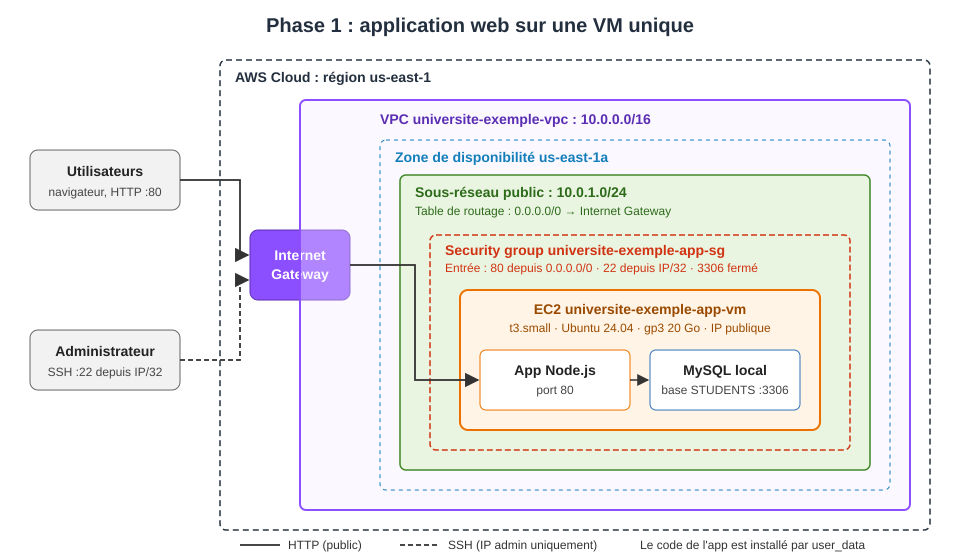

# Phase 1 : Application web sur une VM unique (Terraform / AWS)

## Objectif

Mettre en place un POC qui héberge l'application de gestion des dossiers étudiants sur une seule machine virtuelle EC2, dans un VPC créé par Terraform. À la fin de cette phase, l'application est accessible depuis Internet et les opérations de base (afficher, ajouter, modifier, supprimer un étudiant) fonctionnent.

## Architecture



Éléments déployés :

- **VPC** `10.0.0.0/16` avec un sous-réseau public `10.0.1.0/24` dans la zone `us-east-1a`.
- **Internet Gateway** et **table de routage** qui envoient le trafic sortant vers Internet.
- **Security group** `universite-exemple-app-sg` :
  - port 80 (HTTP) ouvert à tout Internet ;
  - port 22 (SSH) ouvert uniquement à l'IP de l'administrateur ;
  - port 3306 (MySQL) non ouvert : la base n'est pas accessible depuis Internet.
- **Instance EC2** `t3.small` sous Ubuntu 24.04 LTS, avec un volume gp3 de 20 Go. Le script fourni est passé en `user_data` et installe Node.js, MySQL et l'application au premier démarrage.

## Structure du code

```
phase1/
├── main.tf                  # Provider AWS, région, tags communs
├── variables.tf             # Variables (région, CIDR, type d'instance, version Ubuntu, IP SSH, clé publique)
├── network.tf               # VPC, sous-réseau public, Internet Gateway, table de routage
├── security.tf              # Security group et règles (80, 22, sortie libre)
├── compute.tf               # Paire de clés SSH, AMI Ubuntu, instance EC2
├── outputs.tf               # IP publique, URL de l'application, commande SSH, IDs
├── scripts/
│   └── userdata.sh          # Script fourni, copié sans modification
├── terraform.tfvars.example # Modèle à copier en terraform.tfvars
├── architecture-phase1.svg  # Schéma d'architecture
└── README.md
```

Le fichier `.gitignore` à la racine exclut les fichiers d'état (`*.tfstate`), les dossiers `.terraform/`, les fichiers `*.tfvars` (sauf le modèle `.example`) et les clés (`*.pem`, `id_*`).

---

## Guide de démarrage pas à pas

Toutes les commandes sont données pour **PowerShell (Windows)**. Sous Linux/macOS, remplacer `$HOME\.ssh\...` par `~/.ssh/...`.

### Étape 0 : outils à installer (une seule fois)

| Outil | Vérification | Installation |
|---|---|---|
| Terraform ≥ 1.5 | `terraform version` | https://developer.hashicorp.com/terraform/install |
| AWS CLI v2 | `aws --version` | https://aws.amazon.com/cli/ |
| Client SSH | `ssh -V` | inclus dans Windows 10/11 |
| Git | `git --version` | https://git-scm.com/ |

```powershell
git clone <URL_DU_DEPOT>
cd <dossier_du_depot>\phase1
```

### Étape 1 : démarrer le lab et récupérer les identifiants AWS

Les identifiants AWS Academy **expirent à chaque fin de session** : cette étape est à refaire à chaque nouvelle session de lab.

1. Dans AWS Academy, cliquer sur **Start Lab** et attendre que le voyant **AWS** passe au vert.
2. Cliquer sur **AWS Details**, puis sur **Show** à côté de **AWS CLI**.
3. Copier tout le bloc `[default]` affiché (`aws_access_key_id`, `aws_secret_access_key`, `aws_session_token`).
4. Le coller dans le fichier d'identifiants, en remplaçant l'ancien contenu :
   ```powershell
   New-Item -ItemType Directory -Force $HOME\.aws | Out-Null
   notepad $HOME\.aws\credentials
   ```
5. Vérifier que la connexion fonctionne :
   ```powershell
   aws sts get-caller-identity
   ```
   Le résultat doit afficher un `Account` et un `Arn` contenant `voclabs`. En cas d'erreur `ExpiredToken` ou `InvalidClientTokenId`, recommencer les points 2 à 4.

### Étape 2 : créer la clé SSH (une seule fois)

```powershell
ssh-keygen -t ed25519 -f $HOME\.ssh\id_ed25519_phase1 -C "phase1"
```

La clé publique (`.pub`) est envoyée à AWS par Terraform. La clé privée reste sur le poste et n'est jamais versionnée.

### Étape 3 : renseigner ses variables

```powershell
Copy-Item terraform.tfvars.example terraform.tfvars
(Invoke-RestMethod https://checkip.amazonaws.com).Trim()   # affiche votre IP publique
notepad terraform.tfvars
```

Dans `terraform.tfvars`, remplacer l'IP d'exemple par la vôtre suivie de `/32`, **sans espace** (ex. `ssh_allowed_cidr = "46.193.67.188/32"`).

> L'IP publique change selon le réseau utilisé (maison, école, partage de connexion). Si le SSH ne répond plus, refaire cette étape puis `terraform apply`. L'accès HTTP à l'application n'en dépend pas.

### Étape 4 : déployer l'infrastructure

```powershell
terraform init       # Télécharge le provider AWS (première fois uniquement)
terraform fmt        # Formate le code
terraform validate   # Vérifie la syntaxe
terraform plan       # Affiche les ressources à créer (11 ressources)
terraform apply      # Crée l'infrastructure : répondre "yes"
```

À la fin, Terraform affiche les outputs :

```
application_url = "http://<IP_PUBLIQUE>"
instance_id     = "i-0123456789abcdef0"
public_ip       = "<IP_PUBLIQUE>"
ssh_command     = "ssh -i ~/.ssh/id_ed25519_phase1 ubuntu@<IP_PUBLIQUE>"
vpc_id          = "vpc-0123456789abcdef0"
```

Pour les réafficher plus tard : `terraform output`.

### Étape 5 : vérifier les ressources créées

**Avec Terraform** : liste de tout ce qui est géré :

```powershell
terraform state list
```

**Avec AWS CLI** : instance et VPC du projet (filtrés par le tag `Project`) :

```powershell
aws ec2 describe-instances --region us-east-1 `
  --filters "Name=tag:Project,Values=universite-exemple-poc" "Name=instance-state-name,Values=pending,running" `
  --query "Reservations[].Instances[].[Tags[?Key=='Name']|[0].Value,InstanceId,State.Name,PublicIpAddress]" `
  --output table

aws ec2 describe-vpcs --region us-east-1 `
  --filters "Name=tag:Project,Values=universite-exemple-poc" `
  --query "Vpcs[].[Tags[?Key=='Name']|[0].Value,VpcId,CidrBlock]" `
  --output table
```

**Dans la console AWS** :

1. Dans AWS Academy, cliquer sur le voyant **AWS** vert : la console s'ouvre.
2. Vérifier en haut à droite que la région est **N. Virginia (us-east-1)**.
3. **EC2 → Instances** : l'instance `universite-exemple-app-vm` doit être `Running`, avec une IP publique.
4. **VPC → Vos VPC** : `universite-exemple-vpc` (10.0.0.0/16). Les sous-réseaux, la passerelle Internet et la table de routage sont dans le menu de gauche.
5. **EC2 → Security Groups** : `universite-exemple-app-sg`, avec les règles 80 et 22.

### Étape 6 : ouvrir l'application

Ouvrir dans un navigateur l'URL affichée par :

```powershell
terraform output -raw application_url
```

**Le premier démarrage prend 5 à 10 minutes** (installation de MySQL, Node.js et de l'application par le script `user_data`). Une page inaccessible juste après l'`apply` est normale. Pour suivre l'installation :

```powershell
ssh -i $HOME\.ssh\id_ed25519_phase1 ubuntu@$(terraform output -raw public_ip)
```

puis, sur la VM :

```bash
cloud-init status                            # "status: done" quand c'est fini
sudo tail -f /var/log/cloud-init-output.log  # suivi en direct (Ctrl+C pour quitter)
```

L'application est prête quand le log affiche `Server is running on port 80`. Tester alors l'affichage, l'ajout, la modification et la suppression d'un étudiant.

### Étape 7 : tout supprimer en fin de session

```powershell
terraform destroy    # répondre "yes"
```

À faire **avant l'expiration du lab** : sinon les ressources sont supprimées par AWS Academy alors que le fichier d'état local les croit toujours présentes. Dans ce cas, supprimer `terraform.tfstate*` avant le prochain `apply`.

### Dépannage rapide

| Symptôme | Cause probable | Solution |
|---|---|---|
| `ExpiredToken` / `InvalidClientTokenId` | Identifiants du lab expirés | Refaire l'étape 1 |
| `No valid credential sources found` | Fichier `~/.aws/credentials` absent ou mal collé | Refaire l'étape 1 |
| `Invalid CIDR` au `plan` | Espace ou `/32` manquant dans `terraform.tfvars` | Corriger l'étape 3 |
| `no such file` sur la clé `.pub` | Clé SSH non créée | Faire l'étape 2 |
| SSH bloqué (timeout) | Votre IP a changé | Étape 3 puis `terraform apply` |
| `Permission denied (publickey)` | Mauvaise clé ou passphrase incorrecte | Vérifier avec `ssh-keygen -y -f $HOME\.ssh\id_ed25519_phase1` |
| Page web inaccessible | Installation en cours | Attendre / suivre le log (étape 6) |
| `InvalidKeyPair.Duplicate` | Clé restée d'une session précédente | `aws ec2 delete-key-pair --key-name universite-exemple-key` puis `apply` |

---

## Tests effectués

| Test | Résultat |
|---|---|
| Connexion SSH avec la clé dédiée | OK |
| Installation du script (`cloud-init status: done`) | OK |
| Accès à l'application depuis le navigateur (`application_url`) | OK |
| Affichage de la liste des étudiants | OK |
| Ajout d'un étudiant | OK |
| Modification d'un étudiant | OK |
| Suppression d'un étudiant | OK |
| Port 3306 inaccessible depuis Internet | OK (security group) |

## Difficultés rencontrées

1. **Descriptions refusées par AWS** : les descriptions des règles de security group n'acceptent ni accents ni apostrophes. Le premier `apply` a échoué pour cette raison ; les descriptions ont été corrigées.
2. **Espace dans `terraform.tfvars`** : une valeur `46.193.67.188 /32` (avec un espace) a fait échouer le `plan`. Le fichier a été recréé proprement.
3. **Passphrase de la clé SSH** : une passphrase saisie incorrectement produit `Permission denied (publickey)`, qui ressemble à une erreur de clé publique. Vérification faite avec `ssh-keygen -y -f`.
4. **Remplacement de la clé SSH** : changer la paire de clés dans Terraform ne modifie pas la VM existante, car la clé est installée à la création de l'instance. Il a fallu recréer la VM avec `terraform apply -replace="aws_instance.app"`.
5. **Configuration MySQL du script** : le script passe `bind-address` à `0.0.0.0`, ce qui expose MySQL sur toutes les interfaces. La protection repose ici uniquement sur le security group, qui bloque le port 3306 depuis Internet.
6. **Fichiers d'état versionnés par erreur** : `terraform.tfstate` avait été commité lors du premier commit. Il a été retiré du suivi Git et ajouté au `.gitignore`, car il contient les IDs et IP des ressources (et contiendra des secrets dès la phase 2).

## Points d'attention et limites

- **Identifiants en clair** : le mot de passe de la base est écrit dans le script fourni. Ce n'est pas acceptable en production, et la phase 2 doit l'externaliser dans AWS Secrets Manager.
- **Avertissement Secrets Manager au démarrage** : l'application affiche « Secrets not found, proceeding with default values ». Elle fonctionne avec ses valeurs par défaut, mais cela confirme que le code fourni n'utilise pas encore Secrets Manager.
- **SDK obsolète** : le code utilise AWS SDK for JavaScript v2, en fin de support. À migrer vers la v3 dans une phase ultérieure.
- **Adresse IP changeante** : l'IP publique change à chaque recréation de la VM. Il faut relire les outputs après chaque `apply -replace`.
- **Disponibilité** : une seule VM dans une seule zone, donc pas de tolérance à la panne. C'est le sujet de la phase 3.

## Suite

- **Phase 2** : séparer la base de données (RDS MySQL) et l'application, et stocker les identifiants dans Secrets Manager.
