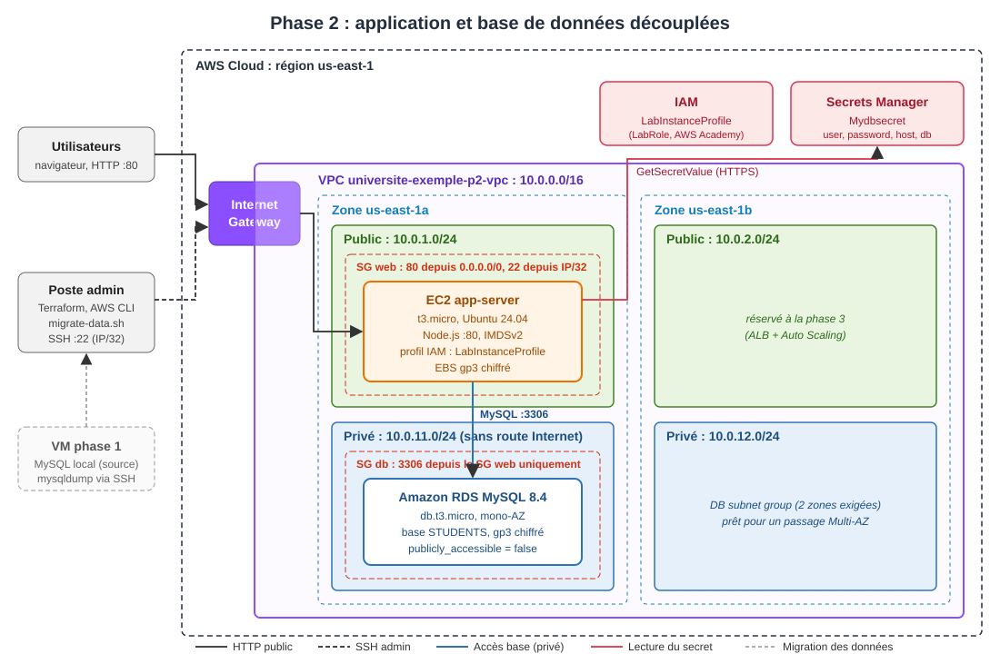

# Phase 2 : Découplage de l'application et de la base de données

## Objectif

Séparer l'application web et la base de données pour qu'elles fonctionnent indépendamment :

- l'application tourne sur une **nouvelle instance EC2** (sans MySQL local) ;
- la base est hébergée sur **Amazon RDS for MySQL**, service managé, dans des **sous-réseaux privés** ;
- les identifiants de la base sont stockés dans **AWS Secrets Manager** et lus par l'application au démarrage : **aucun mot de passe n'est écrit dans le code ni sur la machine** ;
- les données de la phase 1 sont **migrées** vers RDS.

## Architecture



| Composant | Configuration | Justification |
|---|---|---|
| VPC | `10.0.0.0/16`, 2 zones (us-east-1a, us-east-1b) | 2 zones exigées par RDS ; prépare la haute disponibilité de la phase 3 |
| Sous-réseaux publics | `10.0.1.0/24`, `10.0.2.0/24` | Serveur web (et futur équilibreur de charge) |
| Sous-réseaux privés | `10.0.11.0/24`, `10.0.12.0/24`, **sans route vers Internet** | La base n'est pas joignable depuis Internet |
| NAT Gateway | **aucune** | RDS n'a pas besoin d'Internet : environ 32 $/mois économisés |
| SG web | 80 depuis `0.0.0.0/0`, 22 depuis l'IP admin `/32` | Ports strictement nécessaires |
| SG base | 3306 **uniquement depuis le SG web** (référence de SG, pas d'IP) | Seuls les serveurs web parlent à la base |
| RDS MySQL 8.4 | `db.t3.micro`, mono-AZ, gp3 20 Go chiffré (autoscaling jusqu'à 50 Go), `publicly_accessible = false`, sauvegarde 1 jour | Service managé, coût minimal, mono-AZ autorisé par le sujet |
| Groupe de paramètres RDS | `wait_timeout = 10`, `max_connections = 150` | L'application ne ferme jamais ses connexions : MySQL ferme lui-même celles qui sont inactives, et la limite laisse de la marge pour les rafales (voir « Difficultés ») |
| Secrets Manager | secret `Mydbsecret` : `{user, password, host, db}` | Nom et format imposés par le code fourni (`app/config/config.js`) |
| Mot de passe | généré par Terraform (`random_password`, 24 caractères) | Jamais saisi ni écrit par un humain |
| EC2 web | `t3.micro` Ubuntu 24.04, **IMDSv2 obligatoire**, EBS chiffré, profil `LabInstanceProfile` | Plus de MySQL local : une micro suffit ; le profil IAM donne accès au secret sans clé |

### Flux

1. L'utilisateur accède à l'application en HTTP (port 80) via l'Internet Gateway.
2. Au démarrage, l'application appelle `GetSecretValue` sur `Mydbsecret` avec les droits du profil IAM de l'instance.
3. Elle se connecte à RDS sur le port 3306, à travers le réseau privé du VPC.

## Structure du code

À partir de cette phase, le code est organisé en **modules réutilisables** à la racine du dépôt. La phase 3 reprendra les mêmes modules en y ajoutant l'équilibreur de charge et l'Auto Scaling.

```
projet/
├── modules/
│   ├── network/      # VPC, sous-réseaux publics et privés, IGW, tables de routage
│   ├── security/     # Security groups web et base (moindre privilège)
│   ├── database/     # RDS MySQL, DB subnet group, mot de passe aléatoire
│   ├── secret/       # Secret "Mydbsecret" dans Secrets Manager (équivalent du Script-1)
│   └── app_server/   # AMI Ubuntu, paire de clés, instance EC2 avec profil IAM
└── phase2/
    ├── versions.tf              # Versions de Terraform et des providers, provider AWS, tags
    ├── main.tf                  # Assemblage des modules
    ├── variables.tf             # Variables (avec valeurs par défaut sauf l'IP SSH)
    ├── outputs.tf               # URL, IP, endpoint RDS, nom du secret...
    ├── terraform.tfvars.example # Modèle à copier en terraform.tfvars
    ├── scripts/
    │   ├── app-server-userdata.sh  # Installation de l'application au premier démarrage
    │   ├── migrate-data.sh         # Migration phase 1 -> RDS (équivalent du Script-3)
    │   └── init-db.sql             # Schéma vide, si aucune phase 1 n'est disponible
    ├── architecture-phase2.svg
    └── README.md
```

Chaque module contient `main.tf`, `variables.tf`, `outputs.tf` et `versions.tf`.

---

## Guide de démarrage pas à pas

Durée totale : **environ 20 minutes**, dont 10 à 15 minutes d'attente pour la création de RDS.
Les commandes sont données pour **PowerShell**, sauf l'étape 5, qui utilise **Git Bash** (installé avec Git).

### Étape 0 : prérequis

Ce sont les mêmes que pour la phase 1 : Terraform ≥ 1.5, AWS CLI v2, Git (avec Git Bash) et la clé SSH `~/.ssh/id_ed25519_phase1`. Voir les étapes 0 et 2 du [README de la phase 1](../phase1/README.md).

Pour **migrer les données de la phase 1**, la VM de la phase 1 doit être démarrée (`terraform apply` dans `phase1/`). Sans elle, l'étape 5 propose une base vide.

### Étape 1 : identifiants du lab

Démarrer le lab, copier le bloc **AWS CLI** de **AWS Details** dans `~/.aws/credentials`, puis vérifier :

```powershell
aws sts get-caller-identity
```

Le détail est donné à l'étape 1 de la phase 1.

### Étape 2 : variables

```powershell
cd phase2
Copy-Item terraform.tfvars.example terraform.tfvars
(Invoke-RestMethod https://checkip.amazonaws.com).Trim()   # votre IP publique
notepad terraform.tfvars                                   # remplacer l'IP d'exemple, garder /32
```

Toutes les autres variables ont une valeur par défaut adaptée au lab (voir [variables.tf](variables.tf)).

### Étape 3 : déployer

```powershell
terraform init
terraform validate
terraform plan        # 27 ressources à créer
terraform apply       # répondre "yes" ; RDS prend 5 à 15 minutes
```

Terraform crée tout dans le bon ordre : réseau → security groups → RDS → secret (qui contient l'endpoint RDS) → serveur web. Le serveur web est créé **après** le secret, car l'application ne lit le secret qu'une fois, à son démarrage.

Outputs affichés à la fin :

```
application_url = "http://<IP_PUBLIQUE>"
db_name         = "STUDENTS"
db_username     = "admin"
instance_id     = "i-..."
public_ip       = "<IP_PUBLIQUE>"
rds_endpoint    = "universite-exemple-p2-mysql.xxxxxxxx.us-east-1.rds.amazonaws.com"
secret_name     = "Mydbsecret"
ssh_command     = "ssh -i ~/.ssh/id_ed25519_phase1 ubuntu@<IP_PUBLIQUE>"
...
```

### Étape 4 : vérifier les ressources créées

```powershell
terraform state list
```

```powershell
# Serveur web
aws ec2 describe-instances --region us-east-1 `
  --filters "Name=tag:Phase,Values=2" "Name=instance-state-name,Values=pending,running" `
  --query "Reservations[].Instances[].[Tags[?Key=='Name']|[0].Value,InstanceId,State.Name,PublicIpAddress]" `
  --output table

# Base RDS : PubliclyAccessible doit valoir False
aws rds describe-db-instances --region us-east-1 `
  --db-instance-identifier universite-exemple-p2-mysql `
  --query "DBInstances[].[DBInstanceIdentifier,DBInstanceStatus,Engine,EngineVersion,DBInstanceClass,PubliclyAccessible,Endpoint.Address]" `
  --output table

# Secret : présence et métadonnées (sans afficher la valeur)
aws secretsmanager describe-secret --region us-east-1 --secret-id Mydbsecret `
  --query "[Name,ARN,LastChangedDate]" --output table
```

Dans la **console AWS** (région **N. Virginia**) :

- **EC2 → Instances** : `universite-exemple-p2-app-server`. Dans l'onglet **Sécurité**, le rôle IAM affiché est `LabRole`.
- **RDS → Bases de données** : `universite-exemple-p2-mysql`. Dans **Connectivité et sécurité**, « Accessible publiquement » vaut **Non**.
- **Secrets Manager** : `Mydbsecret`. Le bouton « Récupérer la valeur du secret » affiche les 4 clés.
- **VPC → Sous-réseaux** : 2 publics et 2 privés `universite-exemple-p2-*`.

### Étape 5 : migrer les données (Script-3)

Ouvrir **Git Bash** dans le dossier `phase2/`, puis lancer une des deux commandes :

```bash
# Cas 1 : la VM de la phase 1 est démarrée -> migration de ses données
bash scripts/migrate-data.sh

# Cas 2 : pas de phase 1 -> création de la table vide
bash scripts/migrate-data.sh --init
```

Le script :

1. lit les identifiants dans **Secrets Manager** (aucun mot de passe à saisir) ;
2. attend la fin de l'installation du serveur web (`cloud-init status --wait`) ;
3. exporte la base `STUDENTS` de la phase 1 par SSH (`mysqldump`) et en garde une copie dans `phase2/backup/`, qui n'est pas versionné ;
4. l'importe dans RDS **depuis le serveur web**, seul hôte autorisé à joindre la base ;
5. affiche le nombre d'étudiants présents dans RDS.

L'IP de la phase 1 est lue automatiquement dans `../phase1`. Elle peut aussi être passée en argument : `bash scripts/migrate-data.sh <IP_PHASE1>`.

### Étape 6 : tester l'application

```powershell
terraform output -raw application_url
```

Ouvrir l'URL obtenue. Le premier démarrage prend **3 à 5 minutes** après la création de l'instance ; si l'étape 5 a réussi, l'application est forcément prête. Tester l'affichage de la liste (les étudiants de la phase 1 doivent apparaître), puis l'ajout, la modification et la suppression.

Pour vérifier que l'application utilise bien Secrets Manager :

```powershell
ssh -i $HOME\.ssh\id_ed25519_phase1 ubuntu@$(terraform output -raw public_ip) "sudo grep -E 'Server is running|Secrets not found|Successfully connected' /var/log/cloud-init-output.log | sort | uniq -c"
```

Résultat attendu :

```
      1 Server is running on port 80.
      8 Successfully connected to the database.
```

La ligne `Secrets not found. Proceeding with default values` **ne doit pas** apparaître.

### Étape 7 : supprimer en fin de session

```powershell
terraform destroy     # répondre "yes" ; RDS prend 5 à 10 minutes à se supprimer
```

Le secret est supprimé immédiatement (`recovery_window_in_days = 0`) : un nouvel `apply` peut le recréer aussitôt sous le même nom.

### Dépannage rapide

| Symptôme | Cause probable | Solution |
|---|---|---|
| `ExpiredToken` / `InvalidClientTokenId` | Identifiants du lab expirés | Étape 1 |
| `ssh_allowed_cidr doit être une IP unique...` | IP mal saisie dans `terraform.tfvars` | Format `x.x.x.x/32`, sans espace |
| `InvalidKeyPair.Duplicate` | Paire de clés restée d'une session précédente | `aws ec2 delete-key-pair --key-name universite-exemple-p2-key` puis `apply` |
| `You can't create this secret because a secret with this name is already scheduled for deletion` | Secret supprimé manuellement dans la console | `aws secretsmanager delete-secret --secret-id Mydbsecret --force-delete-without-recovery` puis `apply` |
| `DBSubnetGroupAlreadyExists` / `DBInstanceAlreadyExists` | Ressources d'une session précédente non détruites | Les supprimer dans la console RDS, ou les réimporter (`terraform import`) |
| Le script de migration bloque sur SSH | Votre IP a changé | Mettre à jour `terraform.tfvars` en phase 1 **et** en phase 2, puis `terraform apply` dans les deux |
| Page web : erreur 500 / « Table doesn't exist » | Données non migrées | Étape 5 |
| Log : `Secrets not found. Proceeding with default values` | Instance démarrée sans accès au secret | Vérifier le profil IAM, puis `terraform apply -replace="module.app_server.aws_instance.this"` |
| `bash: terraform: command not found` dans Git Bash | PATH de Git Bash incomplet | Fermer et rouvrir Git Bash après l'installation de Terraform |

---

## Tests effectués

Déploiement réel dans le lab AWS Academy le 04/11/2026 :

| Test | Commande / méthode | Résultat |
|---|---|---|
| `terraform apply` | 26 ressources (avant l'ajout du groupe de paramètres) | OK, en 8 min 30 (RDS : 8 min) |
| RDS non publique | `describe-db-instances` → `PubliclyAccessible` | `False` |
| Port 3306 depuis Internet | connexion TCP vers l'endpoint RDS depuis le poste | Refusée (timeout) |
| Chiffrement RDS | `StorageEncrypted` | `True` |
| Version du moteur | `EngineVersion` | `8.4.11` |
| Lecture du secret par l'application | log de démarrage | `Successfully connected to the database`, pas de `Secrets not found` |
| Migration phase 1 → RDS | `bash scripts/migrate-data.sh` (3 étudiants créés en phase 1) | 3 étudiants dans RDS |
| Affichage de la liste | `GET /students/` | Les 3 étudiants migrés apparaissent |
| Ajout | `POST /supplier-add` | OK (id 4 créé) |
| Modification | `POST /supplier-update` | OK (nom et ville modifiés) |
| Suppression | `POST /supplier-remove/4` | OK |
| Profil IAM | Console EC2 → onglet Sécurité | `LabRole` |

**Nouveau test après l'ajout du groupe de paramètres RDS** (même jour, version finale du code) :

| Test | Résultat |
|---|---|
| `terraform apply` | **27 ressources**, OK (RDS : 9 min) |
| Migration lancée juste après l'apply | OK : le script attend que SSH réponde, puis importe 3 étudiants |
| `bash ../phase4/scripts/test-app.sh <URL>` | 6 / 6 tests réussis |
| Paramètres effectifs sur RDS | `wait_timeout = 10`, `max_connections = 150` |
| 300 affichages de la liste en 75 s (contenu vérifié) | **300 / 300** ; 34 connexions ouvertes au plus fort, 1 seule 12 s plus tard |

## Choix techniques

- **Modules Terraform** : chaque couche (réseau, sécurité, base, secret, serveur) est un module indépendant avec ses variables et ses outputs. La phase 3 les réutilise sans duplication.
- **Secret créé par Terraform plutôt que par la CLI** : le Script-1 du sujet (`aws secretsmanager create-secret`) est remplacé par la ressource `aws_secretsmanager_secret_version`. Le secret est ainsi versionné, recréé à l'identique et détruit avec le reste de l'infrastructure. Son contenu reste équivalent :
  ```bash
  aws secretsmanager create-secret --name Mydbsecret \
    --secret-string '{"user":"admin","password":"<généré>","host":"<endpoint RDS>","db":"STUDENTS"}'
  ```
- **Sécurité en profondeur de la base** : sous-réseaux privés sans route Internet, `publicly_accessible = false`, et un security group qui n'accepte que le SG web. Même avec une erreur sur l'un de ces niveaux, la base reste inaccessible depuis Internet.
- **Ordre de démarrage garanti** : l'application lit le secret une seule fois, au lancement, et se rabat sur `localhost` si le secret est absent. Le module `app_server` attend donc la version du secret (`depends_on_ids`) avant de créer l'instance.
- **IMDSv2 obligatoire** : en phase 1, le script lisait l'IP via IMDSv1 (`curl` sans jeton). En phase 2, cet appel n'existe plus et le SDK AWS gère IMDSv2. On peut donc imposer les jetons, ce qui protège contre le vol d'identifiants par SSRF.
- **Chiffrement** : stockage RDS et volume EBS chiffrés au repos (clés gérées par AWS, sans surcoût).
- **MySQL 8.4** : version LTS actuelle. La 8.0 est passée en support étendu payant sur RDS depuis juillet 2026.
- **Coûts** : `t3.micro` + `db.t3.micro` mono-AZ + pas de NAT, soit environ 25 $/mois en fonctionnement continu (hors offre gratuite).

## Difficultés rencontrées

1. **Cloud9 indisponible dans le lab** : `cloud9:ListEnvironments` renvoie `AccessDenied` (AWS a aussi fermé Cloud9 aux nouveaux comptes en 2024). Les scripts du sujet sont donc exécutés depuis le poste local, qui dispose déjà de l'AWS CLI :
   - Script-1 (création du secret) → module Terraform `secret` ;
   - Script-3 (migration) → `scripts/migrate-data.sh`.
2. **Création de rôle IAM interdite** dans AWS Academy : on utilise le profil existant `LabInstanceProfile` (rôle `LabRole`), qui autorise la lecture du secret.
3. **L'application ne crée pas sa table** : sans migration, la page des étudiants renvoie une erreur. D'où le mode `--init` du script de migration, qui crée le schéma quand aucune phase 1 n'est disponible.
4. **Nom et région du secret codés en dur dans l'application** (`Mydbsecret`, `us-east-1`, code à ne pas modifier) : le nom n'est donc pas préfixé par le projet. Deux environnements ne peuvent pas coexister dans le même compte, ce qui est à prendre en compte en phase 3.
5. **Suppression différée des secrets** : par défaut, un secret supprimé reste réservé 7 à 30 jours et bloque sa recréation. Corrigé avec `recovery_window_in_days = 0`.
6. **Fuite de connexions dans le code fourni** (découverte en phase 3) : `app/models/supplier.model.js` ouvre une connexion MySQL à chaque requête sans jamais la fermer (ni `end()`, ni pool). RDS `db.t3.micro` n'accepte que **61 connexions**, et une connexion inactive reste ouverte 8 heures par défaut. Après environ 60 affichages de la liste, la base répond `Too many connections`, et l'application affiche sa page « There was an error »… **avec un code HTTP 200**, ce qui rend le problème invisible pour un simple contrôle du code de retour. Le code ne devant pas être modifié, la correction est faite dans l'infrastructure, avec un groupe de paramètres RDS :
   - `wait_timeout = 10` : MySQL ferme lui-même les connexions inactives après 10 s ;
   - `max_connections = 150` : plus de marge pour les rafales.

   Capacité soutenue sur les pages qui lisent la base : environ `max_connections / wait_timeout` = 15 requêtes/s. Mesures en rafale, en vérifiant le **contenu** de chaque page :

   | Réglage | Pages affichant réellement la liste |
   |---|---|
   | Par défaut (8 h, 61 connexions) | environ 60, puis uniquement des erreurs |
   | `wait_timeout = 30`, 61 connexions | 97 / 150 |
   | **`wait_timeout = 10`, 150 connexions** | **300 / 300** |

   Le script `test-app.sh` (phase 4) vérifie désormais aussi l'absence de la page d'erreur.
7. **Pas de région par défaut dans l'AWS CLI** : le fichier `credentials` du lab ne contient pas de région, et `aws rds describe-db-instances` sans `--region` échoue avec `NoRegion`. Toutes les commandes du README et du script passent donc `--region` explicitement.

## Limites et améliorations possibles

- **Mot de passe dans le fichier d'état** : `random_password` est stocké dans `terraform.tfstate` (local, non versionné). En équipe, il faudrait un backend S3 chiffré avec verrouillage.
- **Base mono-AZ** : une panne de la zone us-east-1a rend la base indisponible. Il suffit de passer `multi_az = true` (le subnet group couvre déjà 2 zones), ce qui double le coût de la base.
- **Un seul serveur web** : il reste un point de défaillance unique, traité par la phase 3 (ALB + Auto Scaling).
- **Rotation du secret** non configurée : elle nécessiterait une fonction Lambda, impossible à créer avec ses rôles dans le lab.
- **Pas de HTTPS** : hors périmètre du sujet.
