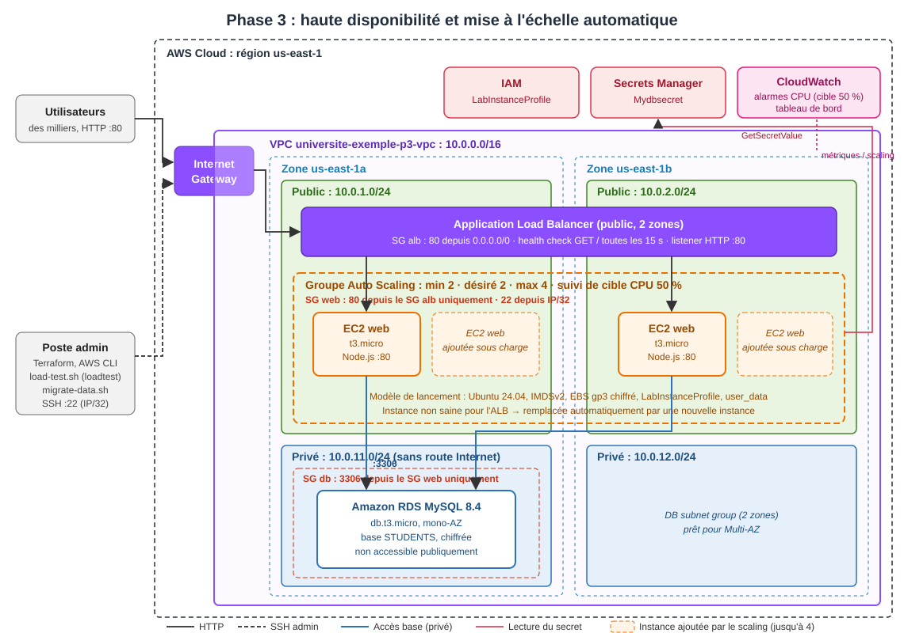

# Phase 3 : Haute disponibilité et mise à l'échelle

## Objectif

Rendre l'application **hautement disponible** et **capable de monter en charge** pendant les pics d'admission :

- un **Application Load Balancer** (ALB) devient le point d'entrée unique et répartit le trafic ;
- un **groupe Auto Scaling**, construit à partir d'un **modèle de lancement**, maintient au moins 2 serveurs web répartis sur 2 zones et en ajoute automatiquement quand la charge augmente ;
- un **test de charge** (Script-2 du sujet, outil `loadtest`) vérifie que la mise à l'échelle fonctionne.

La base RDS, le secret et le réseau de la phase 2 sont repris tels quels, grâce aux mêmes modules Terraform.

## Architecture



### Évolution par rapport à la phase 2

| | Phase 2 | Phase 3 |
|---|---|---|
| Point d'entrée | IP publique d'**une** instance | **DNS de l'ALB** (stable, réparti sur 2 zones) |
| Serveurs web | 1 instance, 1 zone | **2 à 4 instances**, 2 zones, gérées par Auto Scaling |
| Panne d'un serveur | Application indisponible | L'ALB arrête de lui envoyer du trafic en 45 s maximum, et l'ASG le remplace |
| Pic de charge | Saturation | Ajout automatique d'instances (cible : 50 % de CPU moyen) |
| HTTP sur les instances | Ouvert à Internet | **Uniquement depuis l'ALB** (SG alb → SG web) |
| Supervision | Aucune | Tableau de bord CloudWatch (CPU, instances, requêtes, latence, erreurs) |
| Mise à jour des serveurs | Recréation de l'instance (coupure) | Nouvelles instances lancées avant le retrait des anciennes (script `rolling-deploy.sh`, phase 5) |

### Composants ajoutés

| Composant | Configuration | Justification |
|---|---|---|
| ALB | Public, sous-réseaux publics des 2 zones, listener HTTP :80, `drop_invalid_header_fields` | Point d'entrée unique, tolérant à la perte d'une zone |
| Target group | Health check `GET /` toutes les 15 s, sain après 2 succès, non sain après 3 échecs, `deregistration_delay` 30 s | `/` ne dépend pas de la base : une panne RDS ne retire pas toutes les instances (pas de panne en cascade) |
| SG alb | Entrée 80 depuis Internet ; **sortie uniquement vers le SG web** sur le port 80 | Moindre privilège |
| SG web | 80 **depuis le SG alb uniquement**, 22 depuis l'IP admin | Les instances ne sont plus exposées directement en HTTP |
| Modèle de lancement | Ubuntu 24.04, `t3.micro`, IMDSv2 obligatoire, EBS gp3 chiffré, `LabInstanceProfile`, monitoring détaillé (1 min) | Même configuration que le serveur de la phase 2, réutilisable par l'ASG |
| Groupe Auto Scaling | min 2 / désiré 2 / max 4, 2 zones, health check **ELB**, délai de grâce 600 s | 2 instances minimum = une par zone ; max 4 = plafond de coût et limite du lab |
| Politique de scaling | Suivi de cible `ASGAverageCPUUtilization` = 50 % | AWS crée et gère les alarmes : scale-out rapide, scale-in prudent |
| Tableau de bord CloudWatch | CPU, instances désirées / en service / saines, requêtes, latence p95, erreurs 5xx | Observation du test de charge |

## Structure du code

```
projet/
├── modules/
│   ├── network/      # (phase 2) VPC, sous-réseaux, routage
│   ├── security/     # (phase 2, étendu) + SG de l'ALB avec enable_alb = true
│   ├── database/     # (phase 2) RDS MySQL
│   ├── secret/       # (phase 2) Mydbsecret
│   ├── app_server/   # (phase 2) instance unique, non utilisé en phase 3
│   ├── alb/          # NOUVEAU : ALB, target group, listener
│   └── asg/          # NOUVEAU : modèle de lancement, groupe Auto Scaling, politique de scaling
└── phase3/
    ├── versions.tf              # Versions, provider AWS, tags (Phase = 3)
    ├── main.tf                  # Assemblage des modules
    ├── monitoring.tf            # Tableau de bord CloudWatch
    ├── variables.tf             # Variables (taille de l'ASG, cible CPU...)
    ├── outputs.tf               # URL de l'ALB, nom de l'ASG, URL du tableau de bord...
    ├── terraform.tfvars.example
    ├── scripts/
    │   ├── app-server-userdata.sh  # Installation de l'application (identique à la phase 2)
    │   ├── migrate-data.sh         # Chargement des données dans RDS (Script-3)
    │   ├── load-test.sh            # Test de charge + suivi du scaling (Script-2)
    │   └── init-db.sql
    ├── architecture-phase3.svg
    └── README.md
```

Les modules de la phase 2 sont **réutilisés sans duplication**. Le module `security` a reçu une option `enable_alb` (désactivée par défaut) : la phase 2 continue de fonctionner sans aucun changement, ce que confirme `terraform plan` en phase 2 (« No changes »).

---

## Guide de démarrage pas à pas

Durée totale : **environ 25 minutes** (10 minutes de déploiement et 10 minutes de test de charge).
Les commandes sont données pour **PowerShell**, sauf les étapes 5 et 7, qui utilisent **Git Bash**.

### Étape 0 : prérequis

- Les mêmes que pour la phase 1 : Terraform ≥ 1.5, AWS CLI v2, Git (avec Git Bash) et la clé SSH `~/.ssh/id_ed25519_phase1`.
- **Node.js** (≥ 18) pour le test de charge : `node -v`. Installation : https://nodejs.org.
- **La phase 2 doit être détruite** (`terraform destroy` dans `phase2/`). Le code de l'application impose le nom de secret `Mydbsecret` : les deux phases ne peuvent pas coexister dans le même compte.
- Optionnel : la VM de la phase 1 démarrée, pour y reprendre les données.

### Étape 1 : identifiants du lab

Démarrer le lab, copier le bloc **AWS CLI** de **AWS Details** dans `~/.aws/credentials`, puis vérifier :

```powershell
aws sts get-caller-identity
```

### Étape 2 : variables

```powershell
cd phase3
Copy-Item terraform.tfvars.example terraform.tfvars
(Invoke-RestMethod https://checkip.amazonaws.com).Trim()   # votre IP publique
notepad terraform.tfvars                                   # remplacer l'IP d'exemple, garder /32
```

La taille du groupe et la cible CPU se règlent avec `asg_min_size`, `asg_max_size`, `asg_desired_capacity` et `asg_cpu_target` (voir [variables.tf](variables.tf)).

### Étape 3 : déployer

```powershell
terraform init
terraform validate
terraform plan        # 36 ressources à créer
terraform apply       # répondre "yes" ; environ 10 minutes (RDS)
```

Outputs principaux :

```
application_url = "http://universite-exemple-p3-alb-XXXXXXXXX.us-east-1.elb.amazonaws.com"
asg_name        = "universite-exemple-p3-asg"
dashboard_url   = "https://us-east-1.console.aws.amazon.com/cloudwatch/home?region=us-east-1#dashboards/dashboard/universite-exemple-p3-dashboard"
rds_endpoint    = "universite-exemple-p3-mysql.xxxxxxxx.us-east-1.rds.amazonaws.com"
secret_name     = "Mydbsecret"
```

Les instances démarrent **après** la fin de `terraform apply` et sont déclarées saines par l'ALB environ **4 minutes plus tard** (installation de Node.js et de l'application).

### Étape 4 : vérifier les ressources créées

```powershell
terraform state list
```

```powershell
# Groupe Auto Scaling : 2 instances InService, réparties sur 2 zones
aws autoscaling describe-auto-scaling-groups --region us-east-1 `
  --auto-scaling-group-names universite-exemple-p3-asg `
  --query "AutoScalingGroups[0].Instances[].[InstanceId,AvailabilityZone,LifecycleState,HealthStatus]" `
  --output table

# Cibles de l'ALB : 2 "healthy" (attendre environ 4 min après l'apply)
aws elbv2 describe-target-health --region us-east-1 `
  --target-group-arn $(terraform output -raw target_group_arn) `
  --query "TargetHealthDescriptions[].[Target.Id,TargetHealth.State]" --output table

# Politique de scaling
aws autoscaling describe-policies --region us-east-1 `
  --auto-scaling-group-name universite-exemple-p3-asg `
  --query "ScalingPolicies[].[PolicyName,PolicyType,TargetTrackingConfiguration.TargetValue]" --output table
```

Dans la **console AWS** (région **N. Virginia**) :

- **EC2 → Équilibreurs de charge** : `universite-exemple-p3-alb`, état **Active**, 2 zones de disponibilité.
- **EC2 → Groupes cibles** : `universite-exemple-p3-tg`. L'onglet **Cibles** affiche 2 instances **healthy**.
- **EC2 → Groupes Auto Scaling** : `universite-exemple-p3-asg`. L'onglet **Gestion des instances** affiche 2 instances ; l'onglet **Mise à l'échelle automatique** affiche la politique de suivi de cible.
- **EC2 → Modèles de lancement** : `universite-exemple-p3-lt`.
- **CloudWatch → Tableaux de bord** : `universite-exemple-p3-dashboard`.

### Étape 5 : charger les données (Script-3)

Ouvrir **Git Bash** dans `phase3/`, puis lancer une des commandes suivantes :

```bash
bash scripts/migrate-data.sh                                   # depuis la VM de phase 1 (si démarrée)
bash scripts/migrate-data.sh --file ../phase2/backup/<fichier>.sql   # depuis un export de la phase 2
bash scripts/migrate-data.sh --init                            # base vide
```

Le script attend qu'une instance de l'ASG soit en service, lit les identifiants dans Secrets Manager et importe les données dans RDS par cette instance, seule machine autorisée à joindre la base.

### Étape 6 : tester l'application

```powershell
terraform output -raw application_url
```

Ouvrir l'URL obtenue et tester l'affichage, l'ajout, la modification et la suppression d'étudiants.

**Vérifier la répartition de charge** : chaque instance garde ses journaux. Après quelques rechargements de la liste, les deux instances ont reçu des requêtes :

```powershell
aws ec2 describe-instances --region us-east-1 `
  --filters "Name=tag:aws:autoscaling:groupName,Values=universite-exemple-p3-asg" "Name=instance-state-name,Values=running" `
  --query "Reservations[].Instances[].PublicIpAddress" --output text
# puis, pour chaque IP :
ssh -i $HOME\.ssh\id_ed25519_phase1 ubuntu@<IP> "sudo grep -c 'Successfully connected' /var/log/cloud-init-output.log"
```

**Vérifier la haute disponibilité** : terminer une instance et constater que l'application reste accessible :

```powershell
$id = aws autoscaling describe-auto-scaling-groups --region us-east-1 --auto-scaling-group-names universite-exemple-p3-asg --query "AutoScalingGroups[0].Instances[0].InstanceId" --output text
aws ec2 terminate-instances --region us-east-1 --instance-ids $id
# L'application reste accessible ; une nouvelle instance est lancée automatiquement :
aws autoscaling describe-scaling-activities --region us-east-1 --auto-scaling-group-name universite-exemple-p3-asg --max-items 2 --query "Activities[].Description" --output table
```

### Étape 7 : test de charge (Script-2)

Dans **Git Bash**, depuis `phase3/` :

```bash
bash scripts/load-test.sh
```

Le script lance `loadtest --rps 1000 -c 500 -k` (paramètres du Script-2) pendant 10 minutes contre l'ALB, sans installation globale (`npx`). Toutes les 30 secondes, il affiche le CPU moyen, le nombre d'instances désirées / en service et le nombre de cibles saines :

```
11:25:50 | CPU moyen : 3 %    | instances désirées / en service : 2/2     | cibles saines ALB : 2
11:26:23 | CPU moyen : 53 %   | instances désirées / en service : 2/2     | cibles saines ALB : 2   <- charge
11:28:38 | CPU moyen : 64 %   | instances désirées / en service : 3/3     | cibles saines ALB : 2   <- scale-out
11:30:52 | CPU moyen : 64 %   | instances désirées / en service : 3/3     | cibles saines ALB : 3   <- 3e instance saine
11:34:48 | CPU moyen : 59 %   | instances désirées / en service : 4/4     | cibles saines ALB : 3   <- 2e scale-out
```

Il affiche ensuite le résumé de `loadtest` et les activités de mise à l'échelle. Les paramètres sont modifiables : `DURATION=300 RPS=500 bash scripts/load-test.sh`.

Pendant le test, le **tableau de bord CloudWatch** (`terraform output -raw dashboard_url`, à ouvrir depuis la console du lab) montre l'évolution en direct. Le retour à 2 instances (scale-in) intervient environ 15 minutes après la fin de la charge.

### Étape 8 : supprimer en fin de session

```powershell
terraform destroy     # répondre "yes" ; environ 10 minutes
```

### Dépannage rapide

| Symptôme | Cause probable | Solution |
|---|---|---|
| `ResourceExistsException ... Mydbsecret already exists` | La phase 2 est encore déployée | `terraform destroy` dans `phase2/`, puis `apply` |
| `ExpiredToken` / `InvalidClientTokenId` | Identifiants du lab expirés | Étape 1 |
| `502 Bad Gateway` / `503 Service Unavailable` juste après l'apply | Aucune instance encore saine | Attendre environ 4 minutes (étape 4) |
| Cibles `unhealthy` en boucle | Erreur dans le script d'installation | SSH sur l'instance : `sudo tail -50 /var/log/cloud-init-output.log` |
| `InvalidKeyPair.Duplicate` | Clé restée d'une session précédente | `aws ec2 delete-key-pair --key-name universite-exemple-p3-key` |
| Pas de scale-out pendant le test | Charge insuffisante depuis le poste (connexion lente) | Augmenter `DURATION`, ou baisser `asg_cpu_target` (ex. 30), puis `terraform apply` |
| `npx: command not found` | Node.js absent | Installer Node.js, puis rouvrir Git Bash |
| Le script de migration bloque sur SSH | Votre IP a changé | Mettre à jour `terraform.tfvars`, puis `terraform apply` |

---

## Tests effectués

Déploiement réel dans le lab AWS Academy le 04/11/2026.

### Fonctionnement

| Test | Méthode | Résultat |
|---|---|---|
| `terraform apply` | 36 ressources | OK, en 10 min (RDS : 9 min) |
| Instances réparties sur 2 zones | `describe-auto-scaling-groups` | us-east-1a et us-east-1b, `InService` / `Healthy` |
| Migration phase 1 → RDS | `bash scripts/migrate-data.sh` | 3 étudiants dans RDS |
| Affichage, ajout, modification, suppression via l'ALB | requêtes HTTP sur le DNS de l'ALB | OK |
| Répartition de charge | 300 requêtes `GET /students/`, connexions comptées dans le journal de chaque instance | **150 / 150** (aller-retour parfait) |
| Correctif des connexions (1re version, `wait_timeout = 30`) | 300 requêtes `/students/`, `max_connections` = 61 | 300 / 300 en **HTTP 200**, mais le contenu des pages n'était pas vérifié (voir Difficultés, point 5) |
| HTTP direct sur une instance | `curl http://<IP_instance>` sur les 4 instances | Timeout sur les 4 (SG web : port 80 uniquement depuis l'ALB) ; via l'ALB : 200 |

### Haute disponibilité : panne d'une instance

Terminaison brutale d'une instance (`aws ec2 terminate-instances`) pendant que l'application est sondée toutes les secondes :

| Mesure | Résultat |
|---|---|
| Disponibilité pendant 90 s | **87 / 90 requêtes réussies** (96,7 %) |
| Requêtes perdues | 3 timeouts dans les 20 s suivant la terminaison, le temps que le health check (3 échecs × 15 s maximum) retire l'instance |
| Remplacement | Nouvelle instance lancée automatiquement **40 s** après la terminaison |

Les 3 requêtes perdues viennent du caractère **brutal** de la panne simulée. Pour une maintenance planifiée, `aws autoscaling terminate-instance-in-auto-scaling-group` retire d'abord l'instance de l'ALB (*connection draining*, 30 s), sans perte de requêtes.

### Test de charge (Script-2)

`bash scripts/load-test.sh` : `loadtest --rps 1000 -c 500 -k` pendant 600 s contre l'ALB, depuis un poste en France.

| Mesure | Résultat |
|---|---|
| Requêtes traitées | **599 887** en 600 s |
| Débit effectif | **1 000 req/s** (cible atteinte pendant toute la durée) |
| Erreurs | **1** sur 599 887 (0,0002 %) |
| Latence moyenne | 96 ms |
| Latence p50 / p90 / p95 / p99 | 93 / 97 / 105 / 158 ms |

Ces latences correspondent pour l'essentiel à l'aller-retour réseau France → Virginie (environ 90 ms). Le temps de traitement côté serveur reste donc de quelques millisecondes sous charge.

Mise à l'échelle observée :

| Heure | Événement |
|---|---|
| 11:24:38 | Début de la charge (2 instances) |
| 11:26:23 | CPU moyen à 53 %, au-dessus de la cible de 50 % |
| 11:28:18 | **Scale-out 2 → 3** (alarme de suivi de cible, environ 2 min après le dépassement) |
| 11:30:52 | 3e instance saine dans l'ALB (démarrage et installation : environ 2 min 30) |
| 11:34:30 | CPU toujours au-dessus de 50 % : **scale-out 3 → 4** (maximum du groupe) |
| 11:34:38 | Fin de la charge |

## Choix techniques

- **Réutilisation des modules** : la phase 3 n'ajoute que deux modules (`alb`, `asg`) et une option au module `security`. Réseau, base et secret sont strictement identiques à la phase 2.
- **Instances dans les sous-réseaux publics, mais non exposées en HTTP** : seul l'ALB peut les joindre sur le port 80, grâce à une référence de SG. Mettre les instances dans des sous-réseaux privés imposerait une NAT Gateway pour `apt`, `npm` et Secrets Manager, soit environ 32 $/mois par zone, plus que le coût de toutes les instances. Le compromis est assumé pour un POC à coût réduit.
- **Health check ELB dans l'ASG** : une instance qui tourne mais ne répond plus en HTTP (application plantée) est remplacée, et pas seulement une instance arrêtée.
- **Suivi de cible plutôt que paliers** : une seule valeur à régler (50 % de CPU). AWS crée les alarmes de scale-out (3 minutes au-dessus de la cible) et de scale-in (15 minutes en dessous), ce qui évite les oscillations.
- **`ignore_changes = [desired_capacity]`** : un `terraform apply` lancé pendant un pic ne ramène pas le groupe à 2 instances.
- **Délai de grâce de 600 s** : le premier démarrage (`apt` + `npm`) prend 3 à 5 minutes. Un délai plus court ferait remplacer les instances avant qu'elles soient prêtes (boucle infinie).
- **Monitoring détaillé (1 min)** : la politique de scaling réagit en 3 minutes au lieu de 15 avec les métriques par défaut à 5 minutes. Coût : environ 2 $/mois par instance.
- **Coût** : 2 × `t3.micro` + ALB + `db.t3.micro`, soit environ 45 $/mois au repos. Sous charge, 2 instances de plus seulement pendant le pic.

## Difficultés rencontrées

1. **Secret au nom imposé** : `Mydbsecret` est codé en dur dans l'application, ce qui empêche les phases 2 et 3 de coexister. Il faut détruire la phase 2 avant de déployer la phase 3 (documenté dans les prérequis et le dépannage).
2. **Pas de Cloud9** : comme en phase 2, les scripts du sujet sont exécutés depuis le poste. Le Script-2 (test de charge) devient `scripts/load-test.sh`, qui utilise `npx` (pas d'installation globale) et ajoute le suivi du scaling.
3. **Compatibilité avec la phase 2** : ajouter l'ALB au module `security` en modifiant ses ressources existantes aurait forcé la recréation des security groups de la phase 2. La description d'un SG est immuable chez AWS. La solution retenue est une option `enable_alb` qui conserve exactement les mêmes valeurs quand elle est désactivée, vérifiée par un `terraform plan` sans changement en phase 2.
4. **Tags des instances** : les `default_tags` du provider ne s'appliquent pas aux instances lancées par l'ASG. Ils sont recopiés dans le modèle de lancement (`data "aws_default_tags"`), ce qui permet de filtrer les instances par `Project` et `Phase`.
5. **Fuite de connexions dans l'application fournie** : chaque requête ouvre une connexion MySQL qui n'est jamais fermée (ni `end()`, ni pool dans `app/models/supplier.model.js`). Sur `db.t3.micro` (`max_connections` = 61), l'application plantait après environ 60 affichages de la liste, et les 2 à 4 instances se partagent la même limite. Sans modifier le code, la correction passe par le module `database` : un groupe de paramètres RDS qui fait fermer par MySQL les connexions inactives. **Piège** : en cas d'erreur, l'application renvoie sa page « There was an error » avec un code **HTTP 200**. Le premier test, qui ne regardait que le code de retour, a donc surestimé le correctif (`wait_timeout = 30`). En vérifiant le contenu des pages (nouveau test en phase 2), seules 97 pages sur 150 affichaient la liste. Le réglage final, `wait_timeout = 10` et `max_connections = 150`, donne **300 / 300**. Il s'applique aux phases 2 à 4, et `test-app.sh` détecte maintenant la page d'erreur.
6. **Instance « InService » avant d'être prête** : l'ASG déclare une instance en service dès son lancement, avant même que SSH ne réponde. La première exécution du script de migration a échoué (`Connection timed out`). Les scripts réessaient maintenant la connexion SSH toutes les 15 s pendant 5 min.

## Limites et améliorations possibles

- **HTTPS** : un certificat ACM sur le listener (443) avec redirection 80 → 443 nécessite un domaine, hors périmètre du sujet.
- **Instances en sous-réseaux privés** avec NAT Gateway ou VPC endpoints, et accès d'administration par Session Manager au lieu de SSH.
- **Base Multi-AZ** (`multi_az = true`) : aujourd'hui, une panne de us-east-1a coupe la base, même si les serveurs web survivent dans us-east-1b.
- **Image préconstruite** (AMI ou conteneur, phase 4) : le démarrage passerait de 4 minutes à quelques secondes, et le scale-out serait beaucoup plus réactif.
- **Connexions à la base** : les paramètres RDS limitent la fuite, sans la supprimer. La capacité soutenue sur les pages qui lisent la base est d'environ 15 requêtes/s (150 connexions / 10 s), toutes instances confondues. La vraie correction est dans le code (pool `mysql2.createPool`, ou `end()` après chaque requête). On peut aussi utiliser **RDS Proxy** ou une classe de base plus grande, qui accepte plus de connexions.
- **Redémarrage de l'application** : `npm start &` ne relance pas Node.js s'il plante. L'ASG remplace alors l'instance en quelques minutes. Un service `systemd` avec `Restart=always` la relancerait en quelques secondes.
