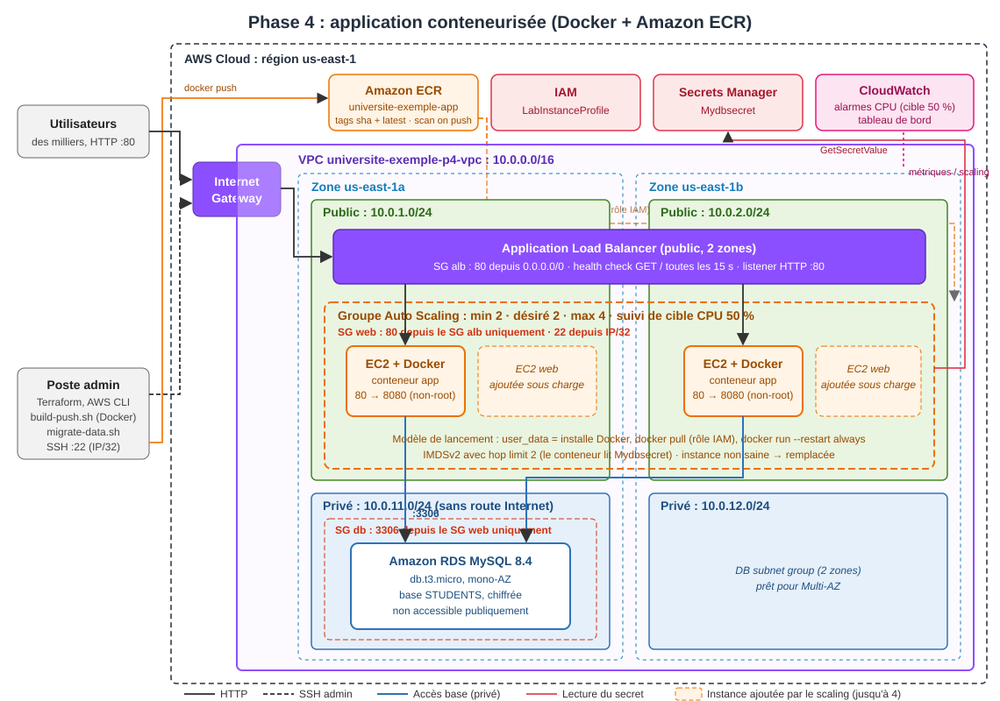

# Phase 4 : Packaging de l'application (Docker + Amazon ECR)

## Objectif

Rendre l'application **facilement déployable** :

- **conteneuriser** l'application avec un `Dockerfile` ;
- **publier** l'image dans un registre privé **Amazon ECR** ;
- **tester** l'image **localement** (sans compte AWS) puis **sur des instances EC2**, derrière l'ALB et l'Auto Scaling de la phase 3.

## Architecture



### Évolution par rapport à la phase 3

| | Phase 3 | Phase 4 |
|---|---|---|
| Installation sur l'instance | `apt install nodejs npm` + téléchargement du code + `npm install` à chaque démarrage | `docker pull` d'une **image prête** |
| Versions des dépendances | `npm install` (version du jour, non reproductible) | `npm ci` sur le `package-lock.json` : **identiques partout** |
| Ce qui tourne en production | Impossible de le savoir exactement | Image identifiée par le **SHA du commit Git** |
| Plantage de Node.js | Processus non relancé, l'ASG remplace l'instance (plusieurs minutes) | `--restart always` : Docker relance le conteneur **en quelques secondes** |
| Utilisateur de l'application | `root` | Utilisateur **non privilégié** `node` (uid 1000) |
| Test hors AWS | Impossible | `docker compose up` sur n'importe quel poste |
| Vulnérabilités | Non vérifiées | **Analyse ECR automatique** à chaque push |

### Ce qui ne change pas

Réseau, security groups, RDS, Secrets Manager, ALB, groupe Auto Scaling et tableau de bord : **mêmes modules Terraform** qu'en phase 3. Seul le script de démarrage des instances change ([scripts/user-data.sh.tftpl](scripts/user-data.sh.tftpl)).

### Composants ajoutés

| Composant | Configuration | Justification |
|---|---|---|
| [Dockerfile](Dockerfile) | Multi-étapes, `node:24-alpine`, `npm ci --omit=dev`, utilisateur `node`, port 8080, `HEALTHCHECK` | Image légère et reproductible, sans privilèges root |
| Dépôt ECR | `universite-exemple-app`, chiffré (AES-256), tags `<sha>` + `latest` | Registre privé dans le même compte : pas d'identifiants à gérer pour les instances |
| Politique de cycle de vie | 10 images maximum, images sans tag supprimées après 1 jour | Coût de stockage maîtrisé |
| Analyse de vulnérabilités | `SCAN_ON_PUSH` (registre) | Chaque image publiée est analysée (CVE) |
| Instances | Docker + `amazon-ecr-credential-helper`, IMDSv2 avec **hop limit 2** | Téléchargement de l'image avec le rôle IAM de l'instance, sans mot de passe |

## Structure du code

```
projet/
├── app/                        # Code de l'application fourni (non modifié)
├── modules/
│   ├── ecr/                    # NOUVEAU : dépôt ECR + politique de cycle de vie
│   ├── dashboard/              # NOUVEAU : tableau de bord CloudWatch (extrait de la phase 3)
│   ├── asg/                    # (étendu) user_data en template + hop limit IMDS réglable
│   └── network, security, database, secret, alb   # inchangés
└── phase4/
    ├── Dockerfile               # Image de l'application
    ├── Dockerfile.dockerignore  # Fichiers exclus de l'image
    ├── docker-compose.yml       # Test local : application + MySQL
    ├── local/init-db.sql        # Données de test locales
    ├── registry/main.tf         # Configuration Terraform du registre ECR (à créer en premier)
    ├── versions.tf, main.tf, variables.tf, outputs.tf, monitoring.tf   # Infrastructure (comme en phase 3)
    ├── terraform.tfvars.example
    ├── scripts/
    │   ├── user-data.sh.tftpl  # Démarrage des instances : Docker + docker run de l'image ECR
    │   ├── build-push.sh       # Construction et publication de l'image dans ECR
    │   ├── test-app.sh         # Test fonctionnel automatique (réutilisé en phase 5)
    │   ├── migrate-data.sh     # Chargement des données dans RDS
    │   └── init-db.sql
    ├── architecture-phase4.svg
    └── README.md
```

**Pourquoi deux configurations Terraform (`registry/` et `phase4/`) ?** Le registre doit exister **et contenir l'image** avant que les instances démarrent. Il doit aussi **survivre** à la destruction de l'infrastructure, pour que la chaîne CI/CD de la phase 5 continue d'y publier. Le séparer évite tout `-target` et rend l'ordre explicite : registre → image → infrastructure.

---

## Guide de démarrage pas à pas

Durée totale : **environ 25 minutes**.
Commandes **PowerShell** pour Terraform ; **Git Bash** pour les scripts `.sh`.

### Étape 0 : prérequis

- Comme les phases précédentes : Terraform ≥ 1.5, AWS CLI v2, Git (avec Git Bash), clé SSH `~/.ssh/id_ed25519_phase1`.
- **Docker Desktop** démarré : `docker version` doit afficher une section `Server`.
- **Les phases 2 et 3 doivent être détruites** : le secret `Mydbsecret` est imposé par le code de l'application.

### Étape 1 : tester l'image localement (sans AWS)

Depuis la **racine du dépôt** :

```bash
docker compose -f phase4/docker-compose.yml up --build -d
docker compose -f phase4/docker-compose.yml ps          # app et db doivent être "healthy"
bash phase4/scripts/test-app.sh http://localhost:8080   # 6 tests fonctionnels
```

L'application est aussi accessible dans le navigateur sur http://localhost:8080 (2 étudiants de démonstration).

> **Comment l'application trouve-t-elle MySQL en local ?** Sans accès AWS, le code fourni se rabat sur ses valeurs par défaut (`localhost`, `nodeapp`, `student12`, `STUDENTS`), qui écrasent toute variable d'environnement. Le conteneur de l'application partage donc la pile réseau du conteneur MySQL (`network_mode: service:db`) : `localhost:3306` désigne MySQL, sans modifier le code. Ces identifiants ne servent **qu'au test local**. Sur AWS, ils viennent de Secrets Manager.

Arrêt : `docker compose -f phase4/docker-compose.yml down -v`

### Étape 2 : identifiants du lab

```powershell
aws sts get-caller-identity
```

(Bloc **AWS CLI** de **AWS Details** copié dans `~/.aws/credentials` : voir la phase 1.)

### Étape 3 : créer le registre ECR

```powershell
cd phase4/registry
terraform init
terraform apply      # 3 ressources : dépôt, cycle de vie, analyse à chaque push
cd ..
```

### Étape 4 : construire et publier l'image

Dans **Git Bash**, depuis `phase4/` :

```bash
bash scripts/build-push.sh
```

Le script construit l'image pour `linux/amd64`, s'authentifie auprès d'ECR avec les identifiants du lab, publie les tags `<sha du commit>` et `latest`, puis affiche le résultat de l'analyse de vulnérabilités.

### Étape 5 : déployer l'infrastructure

```powershell
Copy-Item terraform.tfvars.example terraform.tfvars    # puis y mettre votre IP /32
terraform init
terraform plan        # 36 ressources
terraform apply       # environ 10 minutes (RDS)
```

Les instances démarrent après l'apply : installation de Docker, `docker pull`, puis `docker run`. Elles sont saines dans l'ALB environ **2 minutes** plus tard.

### Étape 6 : charger les données et tester sur EC2

Dans **Git Bash**, depuis `phase4/` :

```bash
bash scripts/migrate-data.sh --init        # ou sans argument : données de la VM de phase 1
bash scripts/test-app.sh "$(terraform output -raw application_url)"
```

### Étape 7 : vérifier ce qui tourne

```powershell
# Image déployée
terraform output image_uri

# Images présentes dans ECR (tags, taille, date)
aws ecr describe-images --region us-east-1 --repository-name universite-exemple-app `
  --query "sort_by(imageDetails,&imagePushedAt)[].[imageTags[0],imageSizeInBytes,imagePushedAt]" --output table

# Conteneur sur une instance : état "healthy", image ECR
ssh -i $HOME\.ssh\id_ed25519_phase1 ubuntu@<IP_INSTANCE> "sudo docker ps --format '{{.Image}} {{.Status}}'"
```

Dans la **console AWS** : **ECR → Repositories → universite-exemple-app** (images, résultats d'analyse), puis **EC2 → Groupes cibles** (2 cibles saines).

### Étape 8 : supprimer en fin de session

```powershell
terraform destroy                         # infrastructure (environ 10 min)
terraform -chdir=registry destroy         # registre et images (facultatif : à garder pour la phase 5)
```

### Dépannage rapide

| Symptôme | Cause probable | Solution |
|---|---|---|
| `error during connect ... dockerDesktopLinuxEngine` | Docker Desktop arrêté | Lancer Docker Desktop, attendre « Engine running » |
| `Registre introuvable` (build-push.sh) | Étape 3 non faite | `terraform apply` dans `phase4/registry` |
| `couldn't find resource` (ECR) au `plan` | Registre absent | Étape 3 |
| `ResourceExistsException ... Mydbsecret` | Phase 2 ou 3 encore déployée | `terraform destroy` dans la phase concernée |
| Cibles `unhealthy` | Image absente d'ECR, ou téléchargement en cours | Étape 4, puis attendre : les instances réessaient pendant 20 minutes |
| Port 8080 déjà utilisé (local) | Autre application sur le poste | Modifier `"8080:8080"` dans `docker-compose.yml` (ex. `"8081:8080"`) |
| `Secrets not found` dans `docker logs` sur EC2 | Le conteneur ne joint pas IMDS | Vérifier `metadata_hop_limit = 2` (déjà réglé dans `main.tf`) |

---

## Tests effectués

Tests réels du 04/11/2026 (poste Windows + Docker Desktop, lab AWS Academy).

### En local

| Test | Résultat |
|---|---|
| `docker compose up --build` | Image construite ; `app` et `db` **healthy** |
| `bash phase4/scripts/test-app.sh http://localhost:8080` | **6 / 6** (accueil, liste, ajout, modification, suppression, 404) |
| Utilisateur du conteneur | `uid=1000(node)`, non root |
| hadolint (seuil : avertissement) | Aucun avertissement |

### Registre ECR

| Test | Résultat |
|---|---|
| `terraform apply` (registry) | 3 ressources |
| `bash scripts/build-push.sh` | Tags `<sha>` et `latest` publiés, image de 78 Mo compressée |
| Analyse de vulnérabilités (scan on push) | **COMPLETE, 0 vulnérabilité** |

### Sur EC2 (derrière l'ALB)

| Test | Résultat |
|---|---|
| `terraform apply` | **36 ressources**, OK |
| Démarrage d'une instance (installation de Docker, pull, run) | Cloud-init terminé en **62 s**, contre environ 4 min en phase 3 avec `npm install` |
| Image exécutée | `docker inspect` : même empreinte (`sha256:3061…`) que l'image testée en local et publiée |
| Lecture du secret dans le conteneur (IMDSv2, hop limit 2) | `Successfully connected to the database`, aucun `Secrets not found` |
| `bash scripts/migrate-data.sh` | 3 étudiants importés dans RDS |
| `bash scripts/test-app.sh <URL de l'ALB>` | **6 / 6** |
| Plantage simulé (`kill -9` du processus Node.js depuis l'hôte) | Conteneur relancé par Docker, HTTP 200 au bout de **2 s** (`RestartCount=1`) |
| `docker restart` avec `--init` | **0,4 s**, contre environ 10 s sans `--init` (Node.js en PID 1 ignore SIGTERM) |

## Choix techniques

- **`node:24-alpine`** : version LTS active de Node.js. L'image Alpine est légère (78 Mo compressée dans ECR).
- **Construction multi-étapes** : l'étape `deps` installe les dépendances, l'image finale ne copie que `node_modules` et le code, sans cache npm.
- **`npm ci` + `aws-sdk` à version figée** : le code a besoin d'`aws-sdk` (v2), absent de `package.json`. Le script d'origine faisait `npm install aws aws-sdk`, ce qui donnait une version différente à chaque installation. Ici, `aws-sdk@2.1692.0` est épinglé. Le paquet `aws` (sans rapport avec AWS) est abandonné.
- **Utilisateur non root + port 8080** : un utilisateur non privilégié ne peut pas écouter sur le port 80. L'hôte redirige donc `80 → 8080` (`docker run -p 80:8080`), et l'ALB et les security groups ne changent pas.
- **`--restart always`** : corrige la limite relevée en phase 3. Si Node.js plante, Docker le relance en quelques secondes, sans attendre le remplacement de l'instance.
- **IMDSv2 avec hop limit 2** : le pont réseau Docker ajoute un saut. Avec la limite à 1, le SDK du conteneur ne reçoit pas les identifiants du rôle et l'application se rabat sur `localhost`. Les jetons IMDSv2 restent obligatoires.
- **`amazon-ecr-credential-helper`** : `docker pull` s'authentifie avec le rôle de l'instance (`LabInstanceProfile`), sans `aws ecr get-login-password` ni identifiants stockés sur la machine.
- **Tag `<sha>` + `latest`** : `latest` permet aux nouvelles instances (scale-out, remplacement) de prendre la dernière version. Le tag SHA garde la traçabilité et permet un retour arrière (`terraform apply -var image_tag=<sha>`).
- **`--provenance=false`** : manifeste d'image simple, seul format analysé par le scan ECR (voir Difficultés).

## Difficultés rencontrées

1. **Valeurs par défaut figées dans le code** : sans Secrets Manager, l'application impose `localhost` et ignore les variables d'environnement. Le test local avec deux conteneurs séparés était donc impossible tel quel. La solution `network_mode: service:db` fait partager la pile réseau du conteneur MySQL au conteneur de l'application.
2. **Analyse de vulnérabilités qui ne se lançait pas** : `scan_on_push = true` sur le dépôt ne suffit pas. C'est la configuration **du registre** (niveau compte) qui décide, et elle ne contenait aucune règle. Elle est ajoutée dans `registry/main.tf` (`aws_ecr_registry_scanning_configuration`).
3. **Image au format « index »** : Docker Desktop ajoute des attestations de provenance et publie un index OCI, qu'ECR n'analyse pas et qui laisse des images sans tag dans le dépôt. Corrigé avec `--provenance=false --sbom=false`.
4. **Docker et IMDS** : la limite de 1 saut, correcte pour les phases 2 et 3, empêche un conteneur d'obtenir les identifiants du rôle. Le module `asg` a reçu une variable `metadata_hop_limit`, qui reste à 1 par défaut et que la phase 4 règle à 2.
5. **Node.js en PID 1** : dans un conteneur, le premier processus ne reçoit pas les traitements de signaux par défaut. Un `kill` dans le conteneur restait sans effet, et `docker stop` attendait 10 s avant de forcer l'arrêt. Ajouter `--init` (et `init: true` dans `docker-compose.yml`) fait de `docker-init` (tini) le PID 1, qui transmet les signaux à Node.js.
6. **Instance refresh interdit dans le lab** : modifier le modèle de lancement a fait échouer `terraform apply` (`autoscaling:StartInstanceRefresh ... explicit deny in a service control policy`). L'instance refresh est devenue une option du module `asg`, désactivée par défaut. Les nouvelles versions sont déployées avec `phase5/scripts/rolling-deploy.sh` (voir phase 5).

## Limites et améliorations possibles

- **Docker installé au démarrage** : une AMI préconstruite (Packer) ou **Amazon ECS / Fargate** supprimerait cette étape et réduirait le démarrage à quelques secondes.
- **`aws-sdk` v2** en fin de support (AWS recommande la v3) : la migration demanderait de modifier `app/config/config.js`, hors périmètre.
- **Analyse BASIC** : elle ne couvre que les paquets du système (Alpine). L'analyse **Enhanced** (Amazon Inspector) couvrirait aussi les dépendances npm.
