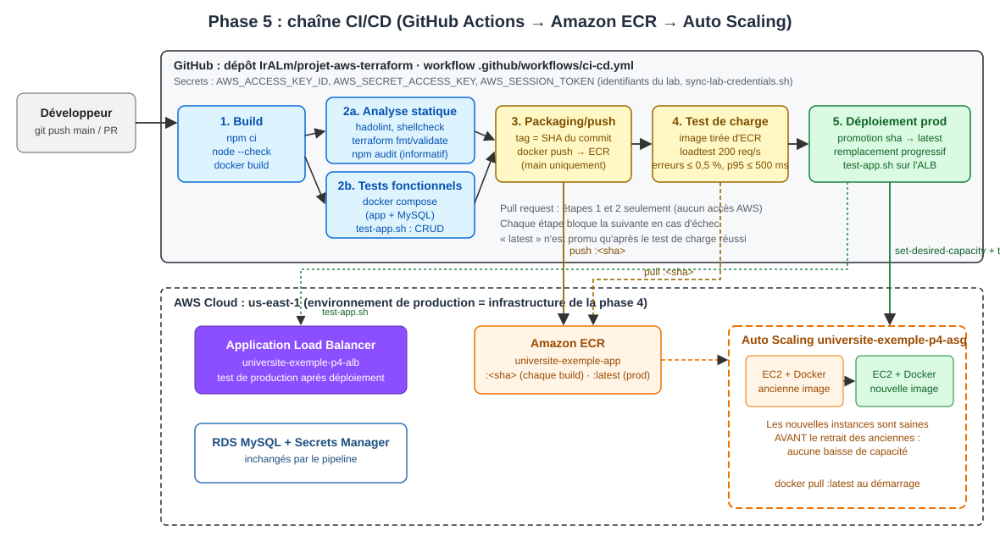

# Phase 5 : Chaîne CI/CD (GitHub Actions)

## Objectif

**Automatiser** la livraison de l'application, du commit jusqu'à la production, avec les étapes demandées :

1. **Build** de l'application ;
2. **Tests de qualité** ;
3. **Packaging et push** de l'image Docker ;
4. **Test de charge** ;
5. **Déploiement** sur l'environnement de production.

L'outil retenu est **GitHub Actions** : le dépôt est déjà sur GitHub, aucun serveur CI n'est à installer, et AWS CodePipeline aurait demandé des rôles IAM que le lab AWS Academy ne permet pas de créer.

## Architecture



L'environnement de **production** est l'infrastructure de la **phase 4** (ALB + Auto Scaling + RDS, instances qui exécutent l'image ECR). Le pipeline ne modifie pas l'infrastructure : il **publie une nouvelle image** et **remplace progressivement les instances**.

## Le pipeline : [`.github/workflows/ci-cd.yml`](../.github/workflows/ci-cd.yml)

| Étape | Job | Ce qui est fait | Bloquant si |
|---|---|---|---|
| **1. Build** | `build` | `npm ci` (versions verrouillées), `node --check` de chaque fichier JS, `docker build`, image transmise aux étapes suivantes (artefact) | erreur de syntaxe, dépendance introuvable, build Docker en échec |
| **2a. Qualité : analyse statique** | `quality-static` | **hadolint** (Dockerfile), **shellcheck** (scripts), **terraform fmt + validate** (5 configurations), **npm audit** (rapport) | avertissement hadolint ou shellcheck, Terraform mal formaté ou invalide |
| **2b. Qualité : tests fonctionnels** | `quality-functional` | Image + MySQL lancés avec `docker compose`, puis `test-app.sh` : affichage, ajout, modification, suppression, 404 ; conteneur **sain** et **non root** | un seul test en échec |
| **3. Packaging et push** | `push` | Image **testée** (la même, pas reconstruite) taguée avec le **SHA du commit** et publiée dans ECR | authentification ou push en échec |
| **4. Test de charge** | `load-test` | Image **tirée d'ECR**, lancée, puis `loadtest` 200 req/s pendant 60 s, puis re-test fonctionnel | **erreurs > 0,5 %** ou **latence p95 > 500 ms** |
| **5. Déploiement production** | `deploy` | Promotion `<sha>` → `latest`, **remplacement progressif** des instances de l'Auto Scaling, puis `test-app.sh` **sur l'ALB de production** | production absente, nouvelles instances non saines en 15 min, test de production en échec |

**Déclencheurs :**

| Événement | Étapes exécutées |
|---|---|
| Pull request vers `main` | 1, 2a, 2b (aucun accès AWS, aucun secret nécessaire) |
| Push sur `main` (code, Dockerfile, pipeline) | 1 à 5 |
| Lancement manuel (onglet **Actions → CI/CD → Run workflow**) | 1 à 5 (déploiement désactivable) |

### Principes

- **Construire une seule fois** : l'image testée en 2b est exactement celle qui est publiée en 3 et déployée en 5 (artefact, puis ECR). On ne reconstruit jamais entre le test et la production.
- **`latest` n'est promu qu'à la fin** : les instances démarrent avec l'image `latest`. Si le test de charge échoue, `latest` désigne toujours l'ancienne version, et un scale-out pendant ce temps ne peut pas déployer une image non validée.
- **Déploiement sans interruption** ([rolling-deploy.sh](scripts/rolling-deploy.sh)) : la capacité désirée est doublée, et les nouvelles instances sont lancées et **déclarées saines par l'ALB avant** le retrait des anciennes. Le retrait se fait ensuite avec `terminate-instance-in-auto-scaling-group`, qui désinscrit d'abord l'instance de l'ALB et laisse finir les requêtes en cours (drainage). Si les nouvelles instances ne deviennent pas saines, la capacité revient à sa valeur initiale et les anciennes restent en service.
- **Vérification en production** : le déploiement n'est réussi que si `test-app.sh` passe sur l'URL publique de l'ALB.
- **Traçabilité** : chaque image porte le SHA du commit, le résumé de chaque exécution affiche l'image déployée et les résultats du test de charge, et l'environnement GitHub `production` garde l'historique des déploiements.
- **Retour arrière** : promouvoir un ancien SHA, puis relancer le remplacement :
  ```bash
  bash phase5/scripts/promote-image.sh universite-exemple-app <ancien_sha> latest
  bash phase5/scripts/rolling-deploy.sh universite-exemple-p4-asg
  ```

## Structure

```
projet/
├── .github/workflows/ci-cd.yml      # Le pipeline (5 étapes)
├── app/                             # Code de l'application (non modifié)
├── phase4/                          # Dockerfile, docker-compose, test-app.sh, infrastructure de production
└── phase5/
    ├── load-test/
    │   ├── load-test-ci.mjs         # Test de charge avec seuils (loadtest utilisé comme bibliothèque)
    │   ├── package.json
    │   └── package-lock.json
    ├── scripts/
    │   ├── promote-image.sh         # Ajoute le tag "latest" à une image ECR sans la retélécharger
    │   ├── rolling-deploy.sh        # Remplacement des instances sans baisse de capacité
    │   └── sync-lab-credentials.sh  # Copie les identifiants du lab dans les secrets GitHub
    ├── architecture-phase5.svg
    └── README.md
```

---

## Guide de mise en route pas à pas

### Étape 0 : prérequis

- La **phase 4 déployée** : registre ECR (`phase4/registry`) **et** infrastructure (`phase4/`). Voir le [README de la phase 4](../phase4/README.md).
- Le dépôt poussé sur **GitHub** (ici `IrALm/projet-aws-terraform`), avec GitHub Actions activé (activé par défaut).

### Étape 1 : donner au pipeline l'accès au lab AWS

Le lab AWS Academy interdit de créer un utilisateur IAM ou une fédération OIDC GitHub → AWS. Le pipeline utilise donc les **identifiants temporaires du lab**, stockés dans les **secrets du dépôt**. Ils **expirent à la fin de chaque session de lab** : cette étape est à refaire à chaque session.

**Option A : GitHub CLI** (`gh`, https://cli.github.com, puis `gh auth login` une fois) :

```bash
# Après avoir mis à jour ~/.aws/credentials avec le bloc "AWS CLI" du lab :
bash phase5/scripts/sync-lab-credentials.sh
```

**Option B : interface web** : **Settings → Secrets and variables → Actions → New repository secret**, puis créer 3 secrets avec les valeurs du bloc **AWS CLI** de **AWS Details** :

| Secret | Valeur |
|---|---|
| `AWS_ACCESS_KEY_ID` | `aws_access_key_id` |
| `AWS_SECRET_ACCESS_KEY` | `aws_secret_access_key` |
| `AWS_SESSION_TOKEN` | `aws_session_token` |

### Étape 2 (facultative) : approbation manuelle avant la production

**Settings → Environments → production → Required reviewers** : le job de déploiement attend alors qu'une personne autorisée clique sur **Approve**. L'environnement `production` est créé automatiquement à la première exécution.

### Étape 3 : déclencher le pipeline

N'importe quelle modification de l'application, ou un lancement manuel :

```bash
git commit --allow-empty -m "ci: déclenchement du pipeline"
git push origin main
```

ou **Actions → CI/CD → Run workflow**.

### Étape 4 : suivre l'exécution

- **Actions → CI/CD →** l'exécution en cours : les 6 jobs s'affichent sous forme de graphe (2a et 2b tournent en parallèle).
- L'onglet **Summary** affiche l'audit npm, l'image publiée, le tableau du test de charge et l'URL de production.
- Côté AWS : **EC2 → Groupes Auto Scaling → universite-exemple-p4-asg → Actualisation d'instance** pour suivre le remplacement des instances, **ECR** pour la nouvelle image `<sha>` et le tag `latest`.

### Dépannage rapide

| Symptôme | Cause probable | Solution |
|---|---|---|
| Étape 3, 4 ou 5 : `The security token included in the request is expired` / `InvalidClientTokenId` | Identifiants du lab expirés | Étape 1, puis **Re-run failed jobs** |
| Étape 3 : `repository ... does not exist` | Registre absent | `terraform apply` dans `phase4/registry` |
| Étape 5 : `Groupe Auto Scaling ... introuvable` | Production non déployée | `terraform apply` dans `phase4/` |
| Étape 5 : `Capacité maximale atteinte` dans le journal | Groupe déjà à 4 instances (pic de charge) | Normal : le script remplace alors les instances une par une ; ou augmenter `asg_max_size` |
| Étape 5 : nouvelles instances non saines après 15 min | Image défectueuse, ou erreur au démarrage | Le script a remis la capacité initiale (anciennes instances intactes) ; voir `/var/log/cloud-init-output.log` sur une nouvelle instance |
| Étape 2a : hadolint, shellcheck ou `terraform fmt` | Code non conforme | Corriger (`terraform fmt -recursive`), puis pousser |
| Étape 4 : seuil dépassé | Régression de performance | Lire le tableau du Summary ; les seuils se règlent dans `ci-cd.yml` (`MAX_ERROR_RATE`, `MAX_P95_MS`) |

---

## Tests effectués

### Briques du pipeline testées sur le vrai environnement (04/11/2026)

Chaque étape a d'abord été exécutée à la main, depuis le poste, contre l'infrastructure réelle de la phase 4 :

| Étape | Test | Résultat |
|---|---|---|
| 2a | hadolint, shellcheck (9 scripts), `terraform fmt -check`, `terraform validate` (5 configurations), actionlint sur `ci-cd.yml` | **Tout passe**, aucun avertissement |
| 2a | `npm audit --omit=dev` | 13 vulnérabilités signalées (2 critiques, 8 élevées), toutes dans les dépendances imposées : rapport non bloquant |
| 2b | `docker compose up` + `test-app.sh` | 6 / 6 |
| 4 | `load-test-ci.mjs` contre le conteneur local (200 req/s, 15 s) | 2 999 requêtes, **0 erreur**, p95 = 2 ms : seuils respectés, code de sortie 0 |
| 5 | `promote-image.sh` (sha → latest) | Empreinte identique vérifiée (`sha256:3061…`) ; nouvelle exécution = « rien à faire » ; tag inexistant = échec (code 1) |
| 5 | `rolling-deploy.sh universite-exemple-p4-asg` | 2 instances remplacées en **1 min 54** : capacité 2 → 4, 4 cibles saines, puis retrait des 2 anciennes avec drainage |
| 5 | Disponibilité pendant ce déploiement (sonde `GET /students/` chaque seconde, contenu vérifié) | **545 / 545 réponses correctes, 0 erreur** sur 12 min (avant, pendant et après le remplacement) : **déploiement sans interruption** |

### Exécution complète sur GitHub Actions

*En attente : nécessite le push du dépôt et l'ajout des 3 secrets AWS (étapes 1 à 3 du guide).*

## Choix techniques

- **GitHub Actions plutôt que CodePipeline** : CodePipeline et CodeBuild demandent des rôles de service IAM que le lab ne permet pas de créer, et GitLab CI demanderait de migrer le dépôt. GitHub Actions est intégré au dépôt existant.
- **Tests de qualité adaptés au contexte** : le code de l'application est fourni et ne doit pas être modifié, et il ne contient aucun test unitaire. La qualité est donc vérifiée là où le projet a la main : Dockerfile, scripts, Terraform, et **tests fonctionnels de bout en bout** sur l'image réelle. L'audit npm est publié mais **non bloquant**, car les failles signalées viennent des versions imposées par le code fourni (voir Limites).
- **Test de charge sur l'image publiée, avant la production** : le sujet place le test de charge entre le push et le déploiement. Le test tourne sur l'image **tirée d'ECR** (l'artefact exact qui sera déployé), dans le runner, avec des **seuils bloquants**. Le test de charge sur l'infrastructure réelle, avec observation de l'Auto Scaling, reste celui de la phase 3 (`load-test.sh`, 1 000 req/s).
- **Seuils** : 200 req/s pendant 60 s, au plus 0,5 % d'erreurs et une latence p95 d'au plus 500 ms. Ils visent à détecter une régression (application qui plante ou ralentit fortement) sans échouer au hasard sur un runner partagé.
- **`loadtest` comme bibliothèque** ([load-test-ci.mjs](load-test/load-test-ci.mjs)) : même outil que le Script-2 du sujet, mais son résultat (erreurs, percentiles) est exploitable pour faire échouer le job, alors que la commande `loadtest` renvoie toujours 0.
- **Actions officielles épinglées par version majeure** (`actions/checkout@v7`, `aws-actions/configure-aws-credentials@v6`...), vérifiées sur leurs dépôts au moment de l'écriture. Le workflow est validé par **actionlint**.
- **Permissions minimales** : `permissions: contents: read` ; les secrets AWS ne sont exposés qu'aux jobs 3 à 5, jamais aux pull requests.

## Difficultés rencontrées

1. **Pas d'identité durable pour la CI dans AWS Academy** : impossible de créer un utilisateur IAM, un rôle ou un fournisseur OIDC. Le pipeline utilise donc les identifiants temporaires du lab, renouvelés à chaque session ; le script `sync-lab-credentials.sh` réduit cette opération à une commande.
2. **Erreurs invisibles** : l'application renvoie sa page d'erreur avec un code **HTTP 200** (voir phase 2, difficulté 6). Un test de fumée basé sur le seul code HTTP aurait validé une production cassée. `test-app.sh` vérifie donc le contenu des pages.
3. **`loadtest` renvoie toujours 0** : utilisé en ligne de commande, il ne peut pas faire échouer un pipeline. D'où le script Node.js qui l'utilise comme bibliothèque et applique des seuils.
4. **Promotion qui changeait l'image** : promouvoir `<sha>` en `latest` consiste à republier le **manifeste** de l'image sous un nouveau tag. Lancé depuis Windows, le script a produit une empreinte différente (`e7f1…` au lieu de `3061…`), car l'AWS CLI convertit les fins de ligne du manifeste en `\r\n`. Les couches étaient identiques, mais `latest` ne désignait plus exactement l'image testée. Le script retire maintenant les `\r` et **vérifie que les deux tags ont la même empreinte**, sinon il échoue.
5. **Instance refresh interdit dans le lab** : la méthode standard pour remplacer les instances d'un Auto Scaling (`StartInstanceRefresh`) est refusée par une politique de l'organisation AWS Academy (`explicit deny in a service control policy`). Ce refus a été découvert lors d'un `terraform apply` qui modifiait le modèle de lancement. Le module `asg` expose donc l'instance refresh en option (`enable_instance_refresh`, désactivée), et `rolling-deploy.sh` reproduit le même principe avec des API autorisées : `set-desired-capacity`, attente des cibles saines, puis `terminate-instance-in-auto-scaling-group`.

## Limites et améliorations possibles

- **Identifiants temporaires** : dans un vrai compte AWS, utiliser la **fédération OIDC GitHub → rôle IAM** (aucun secret stocké, identifiants valables 1 h par exécution).
- **Pas d'environnement de préproduction** : le test de charge tourne dans le runner. Un environnement de staging (deuxième copie de la phase 4) permettrait un test de charge sur une infrastructure identique à la production, mais le secret `Mydbsecret` au nom imposé empêche deux environnements dans le même compte.
- **Dépendances vulnérables** : `npm audit` signale **13 vulnérabilités** dans les versions imposées par le `package-lock.json` fourni, dont **2 critiques** (`mysql2` 2.2.5, `proxy-addr`) et **8 élevées** (`express`, `body-parser`, `qs`...). Les mettre à jour est hors périmètre (code à ne pas modifier), mais c'est la première action à mener avant une vraie mise en production.
- **Image `latest` mutable** : une approche plus stricte ferait référencer le SHA par le modèle de lancement (nouvelle version via Terraform à chaque déploiement), ce qui demande un état Terraform partagé (backend S3) accessible au pipeline.
